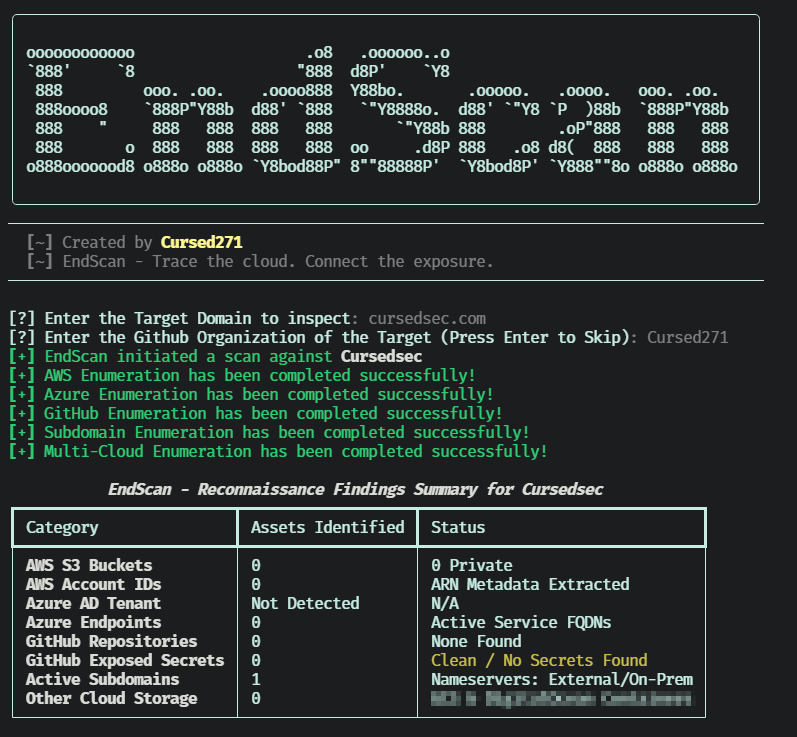

<div align="center">

  

  <h1>EndScan</h1>

  <p align="center">
    
  </p>

  <p align="center">
    
    
    
    
    <a href="./LICENSE">
      
    </a>
  </p>

  <p>Map the Edge. Expose the Oversights.</p>

</div>


## Overview

EndScan is a Python external-reconnaissance utility for authorized cloud, identity, DNS, and source-code exposure assessments.

It combines AWS S3 bucket and account-ID discovery, Microsoft Entra ID tenant metadata, Azure endpoint probing, GitHub organization and repository enumeration, lightweight secret-pattern checks, DNS/subdomain discovery, and Google Cloud or DigitalOcean storage checks into a terminal summary and optional JSON report.

> EndScan performs reconnaissance and pattern-based triage. It does not exploit vulnerabilities, authenticate to cloud services, validate every potential exposure, or establish compromise by itself.

## Features

| Capability | What it does |
| :--- | :--- |
| AWS S3 discovery | Generates likely bucket names from the target domain and optional wordlist, then checks public, private, and redirect responses. |
| AWS account-ID extraction | Reviews selected public endpoints for Amazon Resource Name patterns and extracts candidate 12-digit account IDs. |
| Microsoft Entra ID metadata | Queries OpenID configuration and realm metadata to identify tenant ID, endpoints, namespace type, domain type, and federation branding. |
| Azure endpoint probing | Checks likely Azure service endpoints derived from the target name and tenant ID. |
| GitHub organization discovery | Retrieves public organization metadata and paginated public repository information. |
| GitHub secret triage | Reviews selected common files across `main` and `master` branches for high-signal credential and key patterns. |
| DNS subdomain discovery | Combines public passive sources, custom wordlist candidates, and optional DNS resolution. |
| Nameserver analysis | Resolves NS records and identifies likely AWS Route 53 delegation. |
| Multi-cloud storage checks | Probes likely Google Cloud Storage and DigitalOcean Spaces endpoints. |
| JSON reporting | Exports the complete reconnaissance dataset to a JSON file. |

## Screenshots:

### Interface


## Assessment Coverage

| Area | Checks performed |
| :--- | :--- |
| AWS | Likely S3 bucket names, public/private/redirect status, and ARN-derived account IDs |
| Microsoft Entra ID | Tenant ID, authorization and token endpoints, namespace/domain type, federation brand, and credential-endpoint availability |
| Azure | Blob Storage, Files, Queues, Tables, App Service, Cloud Services, API Management, SQL Database, Redis, Service Bus, Key Vault, B2C, and Front Door endpoint patterns |
| GitHub | Organization metadata, public repositories, repository metadata, and selected secret-pattern checks |
| DNS | Passive subdomain sources, custom wordlist candidates, A-record resolution, NS records, and Route 53 detection |
| Other cloud storage | Google Cloud Storage and DigitalOcean Spaces endpoint patterns |

## Secret Triage

EndScan reviews a limited set of commonly exposed files in public GitHub repositories:

- `README.md`
- `config.json`
- `settings.json`
- `.env.example`
- `.env`
- `docker-compose.yml`
- `package.json`

It searches those files for patterns associated with AWS access keys, GitHub tokens, generic API keys, password-like configuration values, and private-key headers.

> A pattern match is an investigation lead, not confirmed credential validity, active access, or a confirmed security incident. Do not use, share, or assume ownership of discovered credentials.

## Technology

| Component | Purpose |
| :--- | :--- |
| Python | Application runtime |
| Typer | Command-line options and help |
| Rich | Banner placeholder, progress indicators, and summary table |
| requests | HTTP, GitHub API, cloud-endpoint, and public-source queries |
| urllib3 | TLS warning suppression for assessment workflows |
| dnspython | Optional DNS resolution and nameserver analysis |
| re | ARN, tenant-ID, and secret-pattern matching |
| json / pathlib | Report serialization and file handling |

## Installation

### Prerequisites

- Python 3 with `pip`.
- Internet access for external reconnaissance sources and APIs.
- DNS access for subdomain and nameserver checks.
- Optional GitHub personal access token for higher API availability.
- Authorization to assess the target domain, cloud resources, and GitHub organization.

Install dependencies:

```bash
python3 -m pip install rich typer requests urllib3 dnspython
```

Clone and display help:

```bash
git clone https://github.com/Cursed271/EndScan.git
cd EndScan
python3 EndScan.py --help
```

Use an isolated Python environment. If your environment uses `python` rather than `python3`, substitute that interpreter consistently.

## Usage

Use EndScan only for domains, cloud resources, and GitHub organizations you are authorized to assess.

| Use case | Command |
| :--- | :--- |
| Interactive assessment | `python3 EndScan.py` |
| Display help | `python3 EndScan.py --help` |
| Assess a domain | `python3 EndScan.py -d example.com` |
| Specify GitHub organization | `python3 EndScan.py -d example.com -g example-org` |
| Use a GitHub token | `python3 EndScan.py -d example.com -g example-org -t <token>` |
| Supply a wordlist | `python3 EndScan.py -d example.com -w wordlist.txt` |
| Export JSON | `python3 EndScan.py -d example.com -o reports/endscan.json` |
| Combine options | `python3 EndScan.py -d example.com -g example-org -w wordlist.txt -o reports/endscan.json` |

## Command-Line Options

| Option | Short | Default | Purpose |
| :--- | :--- | :--- | :--- |
| `--domain` | `-d` | Interactive prompt | Target domain to inspect |
| `--github` | `-g` | Domain-based organization guess | GitHub organization to assess |
| `--token` | `-t` | None | GitHub personal access token; input is hidden |
| `--wordlist` | `-w` | None | Path to a custom wordlist |
| `--output` | `-o` | None | JSON report destination |
| `--help` | `-h` | — | Show help |

## Output & Interpretation

### Terminal Summary

| Category | Interpretation |
| :--- | :--- |
| AWS S3 Buckets | Number of candidate buckets classified as public, private, or redirect |
| AWS Account IDs | Candidate AWS account IDs extracted from ARN patterns |
| Azure AD Tenant | Whether an Entra ID tenant ID was resolved |
| Azure Endpoints | Number of responding candidate Azure service endpoints |
| GitHub Repositories | Number of public repositories discovered for the organization |
| GitHub Exposed Secrets | Number of pattern matches across reviewed files |
| Active Subdomains | Number of discovered subdomains and identified nameserver provider |
| Other Cloud Storage | Number of responding Google Cloud Storage or DigitalOcean Spaces endpoints |

### JSON Report

The JSON report contains the full reconnaissance dataset, including:

- Target domain and GitHub target
- AWS bucket classifications and account IDs
- Microsoft Entra ID tenant metadata and Azure endpoint findings
- GitHub organization metadata, repositories, and secret-pattern findings
- DNS nameserver and subdomain results
- Google Cloud Storage and DigitalOcean Spaces findings

## Findings Interpretation

| Finding | What it means | What it does not mean |
| :--- | :--- | :--- |
| Public S3 response | The bucket returned HTTP 200 during the assessment | The bucket is intentionally public, safe, or free of sensitive objects |
| Private S3 response | The bucket returned HTTP 403 | The bucket exists, is secure, or contains no accessible data |
| Redirect S3 response | The bucket returned HTTP 301 | The redirect destination is safe or authorized |
| Azure endpoint response | The endpoint returned an expected HTTP status | The service is vulnerable, reachable in production, or misconfigured |
| GitHub secret pattern | A high-signal pattern was observed in a reviewed file | The credential is valid, active, exploitable, or attributable to the organization |
| Resolved subdomain | The hostname resolved to at least one A record | The host is in scope, secure, or intended for public access |
| Route 53 detection | Nameserver patterns suggest AWS Route 53 | The domain has no other DNS provider or cloud footprint |

## Known Limitations

- S3 discovery is candidate-based and does not enumerate every possible bucket name.
- A 403 response does not prove bucket existence or nonexistence.
- GitHub secret checks cover only selected files, branches, and regex patterns.
- Secret-pattern matching can produce false positives and does not validate credentials.
- GitHub API access may be rate-limited without a token.
- Azure endpoint discovery is pattern-based and may miss custom or nonstandard resource names.
- Passive subdomain sources may be incomplete, outdated, or unavailable.
- TLS certificate verification is disabled for many HTTP checks.
- Errors from individual sources are often suppressed rather than surfaced.
- The tool does not perform exploitation, credential validation, authenticated cloud enumeration, or active vulnerability scanning.

## Safe Use

- Obtain explicit authorization before assessing a domain, cloud tenant, GitHub organization, or cloud resource.
- Start with a known domain and a small, relevant wordlist.
- Use a dedicated GitHub token with the minimum required scope; never commit or share it.
- Treat secret-pattern findings as confidential and validate them through an authorized owner or security process.
- Do not attempt to use, reset, transfer, or disclose discovered credentials.
- Protect JSON reports containing internal domains, tenant IDs, repository names, and potential secret matches.
- Review third-party terms and data-handling obligations before using external APIs and passive sources.

## Troubleshooting

| Problem | What to check |
| :--- | :--- |
| No AWS buckets found | Domain-derived naming assumptions, wordlist coverage, and network access |
| No account IDs found | Public endpoint availability and ARN patterns in accessible content |
| Azure tenant not detected | Domain configuration, Microsoft endpoint availability, and custom domain setup |
| No Azure endpoints found | Resource naming, tenant ID availability, and endpoint exposure |
| GitHub rate limit | Token validity, API quota, and request frequency |
| No repositories found | Organization name, public repository visibility, and GitHub API access |
| No subdomains found | Passive-source availability, DNS resolution, and wordlist coverage |
| JSON export fails | Destination permissions, available disk space, and path validity |

## Version History

| Version | Scope |
| :--- | :--- |
| Version 1 | AWS, Microsoft Entra ID/Azure, GitHub, DNS, and multi-cloud storage reconnaissance with JSON export |

## License & Usage

EndScan is distributed under the CursedSec Ownership Edict (COE).

Read [LICENSE](./LICENSE) for the applicable permissions, restrictions, contribution terms, and disclaimers. Public source availability is not a substitute for those terms.

## Feedback & Contributions

Use the repository's bug-report or feature-request template when issue submission is available.

Include the version, operating system, sanitized command, target type, and reproduction steps. Never publish client domains, tenant IDs, repository names, credentials, tokens, or sensitive infrastructure details.

Check the security-reporting instructions before disclosing a vulnerability. Review the license and contribution terms before submitting modifications.

## Connect & Collaborate

<div align="center">

  <a href="https://github.com/Cursed271">
    
  </a>
  <a href="https://www.cursedsec.com/">
    
  </a>
  <a href="https://www.linkedin.com/in/cursed271/">
    
  </a>

  <p>Recon with permission. Triage with care. Protect the evidence.</p>
  <sub>CursedSec.com · Cursed271 · EndScan</sub>

</div>


